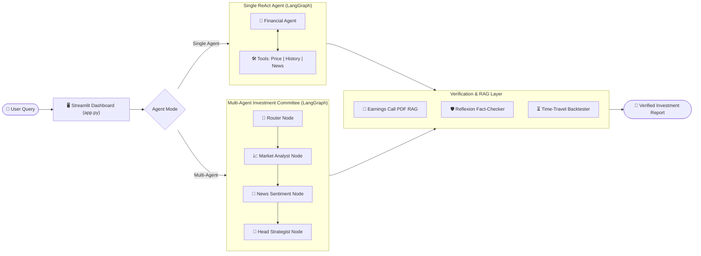

# AI Financial Analyst Agent

[](https://www.python.org/)
[](https://langchain-ai.github.io/langgraph/)
[-purple.svg)](https://console.groq.com/)
[](https://streamlit.io/)
[](https://opensource.org/licenses/MIT)

An end-to-end **Agentic AI Financial Research & Analysis Platform** built with **LangGraph**, **Groq (Llama 3.1)**, **yfinance**, **RAG**, and **Streamlit**.

This project implements a complete multi-agent financial research workflow capable of retrieving live stock fundamentals, analyzing historical technical trends, evaluating real-time news sentiment, querying PDF earnings call transcripts via Retrieval-Augmented Generation (RAG), auditing its own outputs against hallucinations using a **Reflexion** loop, and backtesting recommendations via historical time-travel simulation.

---

## ✨ Key Features

- **📊 Real-Time Market Data & Technical Charting**: Live fundamentals (Price, Market Cap, Trailing/Forward P/E, EPS, 52-Week Range, Analyst Consensus) via Yahoo Finance (`yfinance`) paired with interactive **Plotly** OHLC candlestick charts, 20/50-day Simple Moving Averages (SMA), and volume bars.
- **⚡ Single ReAct Agent Mode**: Fast tool-calling agent powered by **LangGraph** and **Groq (`llama-3.1-8b-instant`)** that dynamically invokes market price, historical performance, and news tools to answer targeted financial queries.
- **🏛️ Multi-Agent Investment Committee**: Specialized four-node **LangGraph** state machine that decomposes complex investment research across:
  1. **Router Agent** — Extracts the target ticker symbol and query intent.
  2. **Quantitative Market Data Analyst** — Evaluates valuation ratios, price action, and technical momentum.
  3. **Financial News & Sentiment Analyst** — Scrapes recent financial headlines and classifies market sentiment, catalysts, and risks.
  4. **Head Portfolio Strategist** — Synthesizes quantitative and qualitative findings into a structured executive report with a `BUY` / `HOLD` / `SELL` recommendation.
- **📄 Earnings Call RAG (Retrieval-Augmented Generation)**: Upload PDF earnings releases, 10-K/10-Q filings, or call transcripts directly in the sidebar to chunk, index, and query management commentary and guidance.
- **🛡️ Reflexion (Self-Correction & Hallucination Guard)**: Iterative `Draft -> Critique -> Revise` compliance loop where an Auditor agent verifies every metric in the analyst's draft against raw tool outputs before finalizing the report.
- **⏳ Time-Travel Backtesting Engine**: Evaluates agent recommendations on historical dates (`as_of_date`) strictly without look-ahead bias, comparing the AI's historical `BUY` / `HOLD` / `SELL` call against actual 30-day forward returns.

---

## 🏗️ System Architecture



---

## 📂 Repository Structure

```text
├── app.py                           # Part 4: Complete Streamlit Web Application & Dashboard
├── AI_Financial_Analyst_Part1.py    # Part 1: MarketData pipeline, DuckDuckGo/Yahoo news & Plotly charts
├── AI_Financial_Analyst_Part2.py    # Part 2: LangChain @tool definitions, Single Agent & Multi-Agent LangGraph
├── AI_Financial_Analyst_Part3.py    # Part 3: EarningsRAG (PDF ingestion & search), ReflexionAgent & BacktestingEngine
├── AI_Financial_Analyst.ipynb       # Complete 8-Week Implementation Jupyter Notebook (end-to-end walkthrough)
├── requirements.txt                 # Python dependencies
└── README.md                        # Project documentation
```

---

## 🗓️ 8-Week Engineering Roadmap

The project is organized into three progressive engineering phases (documented cell-by-cell in [`AI_Financial_Analyst.ipynb`](./AI_Financial_Analyst.ipynb)):

| Phase | Weeks | Module | Core Deliverables |
| :--- | :--- | :--- | :--- |
| **Phase 1: Foundation & Data Engineering** | Weeks 1–2 | `Part 1` | `MarketData` class (`yfinance`), DuckDuckGo news scraper with fallbacks, Plotly OHLC + SMA 20/50 + Volume charts, and Groq Llama 3 connection. |
| **Phase 2: Agent Orchestration & RAG** | Weeks 3–5 | `Part 2` & `Part 3` | `@tool` bindings, ReAct `StateGraph`, Multi-Agent Investment Committee (`Router` -> `Market` -> `News` -> `Head Analyst`), and PDF Earnings Call RAG pipeline. |
| **Phase 3: Advanced Logic & Polish** | Weeks 6–8 | `Part 3` & `app.py` | `ReflexionAgent` self-correction loop, look-ahead-free `BacktestingEngine`, and full two-column Streamlit web interface. |

---

## 🚀 Getting Started

### 1. Prerequisites
- **Python 3.10+**
- A free **Groq API Key** from [console.groq.com](https://console.groq.com)

### 2. Clone the Repository & Set Up Environment

```bash
# Clone the repository
git clone https://github.com/<your-username>/ai-financial-analyst.git
cd ai-financial-analyst

# Create and activate a virtual environment (Windows PowerShell)
python -m venv .venv
.\.venv\Scripts\Activate.ps1

# Or on macOS / Linux:
# python3 -m venv .venv
# source .venv/bin/activate

# Install dependencies
pip install -r requirements.txt
```

### 3. Run the Streamlit Web Dashboard

```bash
streamlit run app.py
```

The application will open in your browser at **`http://localhost:8501`**.
1. Paste your **Groq API Key** in the left sidebar (or export `GROQ_API_KEY` in your environment).
2. Enter any stock ticker (e.g., `AAPL`, `NVDA`, `MSFT`, `TSLA`) to view live metrics, interactive candlestick charts, and news on the right panel.
3. Choose between **Single Agent** (fast tool-assisted Q&A) or **Multi-Agent (Full Analysis)** (comprehensive investment memo) in the sidebar.
4. *(Optional)* Upload an earnings release PDF in the sidebar to index it for RAG queries.

### 4. Run the Jupyter Notebook

To explore the step-by-step 8-week implementation, including standalone demonstrations of **ChromaDB RAG**, **Reflexion**, and **Multi-Ticker Historical Backtesting**:

```bash
jupyter notebook AI_Financial_Analyst.ipynb
```

---

## 💬 Example Queries to Try

- **Quick Valuation & Trend (Single Agent)**:
  - *"What is AAPL's current price, P/E ratio, and 30-day price performance?"*
  - *"Summarize the latest news headlines for TSLA."*
- **Deep Investment Research (Multi-Agent Committee)**:
  - *"Perform a complete investment analysis on NVIDIA (NVDA) and give a BUY/HOLD/SELL recommendation."*
  - *"Compare Microsoft's (MSFT) valuation multiples with its recent news sentiment."*
- **Earnings Call RAG (with uploaded PDF)**:
  - *"What did management state about next quarter's revenue guidance and gross margins?"*

---

## 🛠️ Tech Stack

| Category | Technology | Purpose |
| :--- | :--- | :--- |
| **LLM Inference** | [Groq Cloud](https://groq.com/) (`llama-3.1-8b-instant`) | Low-latency tool calling, reasoning, and report synthesis |
| **Agent Framework** | [LangGraph](https://github.com/langchain-ai/langgraph) & [LangChain](https://www.langchain.com/) | Stateful ReAct loops and multi-agent graph orchestration |
| **Market Data** | [yfinance](https://github.com/ranaroussi/yfinance) & [Pandas](https://pandas.pydata.org/) | Real-time fundamentals, OHLCV history, and technical indicators |
| **News Ingestion** | [DuckDuckGo Search](https://github.com/deedy5/duckduckgo_search) | Live financial news headlines and article snippets |
| **RAG & Document Parsing** | [PyPDF2](https://pypdf2.readthedocs.io/) & [ChromaDB](https://www.trychroma.com/) | PDF transcript extraction, chunking with overlap, and retrieval |
| **Visualization & UI** | [Streamlit](https://streamlit.io/) & [Plotly](https://plotly.com/python/) | Interactive web dashboard and financial candlestick charts |

---

## ⚠️ Disclaimer

This software is provided strictly for **educational and research purposes**. Nothing generated by the AI agents, backtesting engine, or dashboard constitutes financial, investment, legal, or tax advice. Always conduct your own due diligence and consult a certified financial professional before making investment decisions.

---

## 📄 License

This project is licensed under the **MIT License**.
